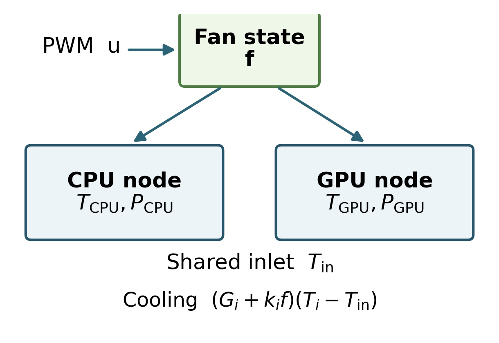
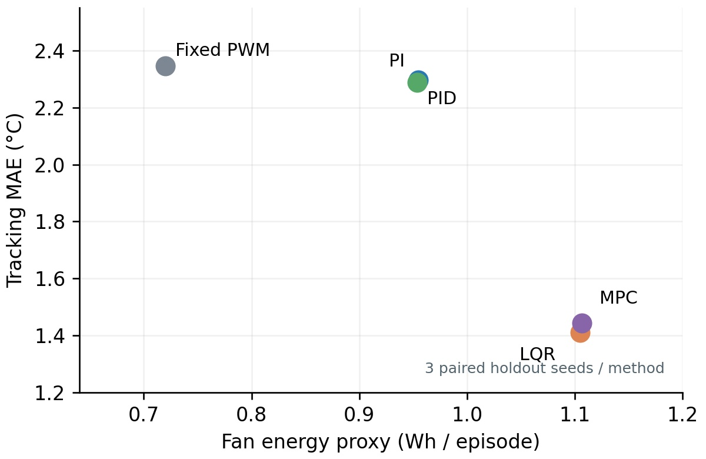

# 機箱雙熱節點模型下五種風扇控制策略之模擬比較

作者：林昀佑¹、易昶霈¹、沈慧宇²

¹ 國立彰化師範大學資訊工程學系；² 建國科技大學電機工程系

## 摘要

風扇控制策略的比較若採不同負載、熱模型或致動限制，所得排名難以直接歸因於策略。本研究在同一個假設CPU/GPU雙熱節點模型中，以相同的逐步外生負載、初始條件及輸出限制，比較固定PWM基準、PI、PID、線性二次調節器（LQR）與模型預測控制（MPC）。五策略各用三組候選、三個校準種子選參；凍結後在驗證、保留測試、指定參數失配及過載四組完成60個正式回合。保留測試組的平均追蹤MAE依序為2.3462、2.2964、2.2879、1.4104及1.4428°C；LQR相較PID低38.35%，但依假設風扇功率公式計算的能耗代理高15.83%。指定失配組以MPC的平均MAE最低；過載組全部方法均超溫，且MPC有一步因求解殘差超過接受門檻而回退。本比較僅描述完整當下狀態可見、有限候選及指定熱模型中的結果，尚不支持實體機箱效能或實測節能結論。

關鍵詞：機箱熱管理、風扇控制、控制策略比較、線性二次調節器、模型預測控制

## 一、前言

電子設備的熱源負載會隨工作階段改變，風扇命令又受延遲與轉速限制。既有研究以模型預測控制處理筆記型電腦的溫度問題[1]，顯示模型式策略可作為熱管理選項，但其設備、目標與負載並非本研究條件。回授控制與預測控制也各有不同的模型需求及限制處理方式[2-4]。因此，單憑不同研究中的單一誤差數字，不能推斷何者在同一機箱環境較佳。

本研究以共同的假設雙節點熱模型及事前固定的選參預算，回答三個問題：名義條件下五種既定策略的追蹤誤差與風扇代價如何取捨；指定參數失配與過載是否改變結果；現有數據能支持哪些解釋。所有方法在同一分組與種子下使用相同入口溫度、負載序列、初始條件和致動規則。本文報告觀測結果與反例，並保留完整原始回合；研究貢獻在於可核對的共同協定比較，而非提出新的控制定律。

## 二、熱模型與共同評估條件

本研究將CPU與GPU視為兩個熱容量節點，以同一風扇狀態f影響各自對入口空氣的散熱。T_i為節點溫度（°C）、P_i為熱功率（W）、T_in為入口溫度（°C）、C_i為熱容量（J/K）、G_i和k_i分別為基礎與風扇相關熱導（W/K），u為正規化PWM。方程由本研究假設及能量平衡整理，並非實測機箱辨識結果：

$$
\begin{aligned}
C_i\frac{\mathrm dT_i}{\mathrm dt}&=P_i-(G_i+k_i f)(T_i-T_{\mathrm{in}}),\\
\frac{\mathrm df}{\mathrm dt}&=\frac{u-f}{\tau}.
\end{aligned}\tag{1}
$$

名義CPU/GPU參數依序為C=1200/1800 J/K、G=1.5/2.0 W/K、k=6/8 W/K；風扇tau=20秒。模型設定的最高轉速為6000 RPM，並非實測風扇曲線。此模型沒有CPU/GPU直接傳熱、機箱幾何、空氣流場或感測雜訊。圖一標示節點與共同風扇關係。

每回合控制120步、每步10秒，共1200秒。熱方程以1秒Euler積分，風扇以一階精確更新。初始CPU/GPU溫度分別為58+(seed mod 3)及59+(seed mod 3)°C，初始f及前一u均為0.5；目標均為60°C。CPU/GPU的警告值為75/80°C，評分上限為80/85°C。所有方法的PWM範圍為0.2至1，每次變化至多0.1；共同警告或求解失敗時請求提高風扇，但仍經相同限幅與限速。

入口溫度每步為29+(seed mod 3-1)+1.5 I(t>=400 s)+0.5 I(t>=800 s)+U[-0.2,0.2]°C。CPU/GPU功率段依當前步數平均分段，再分別加入U[-5,5]及U[-8,8] W擾動。各組的主要功率段與種子列於表一；同一組別及種子的五種方法共用外生序列。所有方法都能讀到當下真實CPU/GPU溫度與f狀態、入口與功率，但不知道未來負載。因此本篇為完整狀態可見的控制律比較，並未評估稀疏感測或狀態估測。

**表一　共同評估分組與功率段（每項為CPU/GPU，W；種子前綴102）**

| 分組 | 種子末三碼 | 依時間排序的CPU/GPU功率段 |
| --- | --- | --- |
| 校準 | 601–603 | 90/130; 170/235; 120/165; 185/255 |
| 驗證 | 611–613 | 125/180; 205/285; 75/115; 160/225 |
| 保留測試 | 621–623 | 175/245; 85/135; 215/295; 110/160; 155/220 |
| 參數失配 | 631–633 | 同保留測試 |
| 過載 | 641–643 | 440/580 |

參數失配組將真實plant依種子分別改為：(102631) CPU/GPU的C倍率0.90/1.15、G倍率0.95/1.05、k倍率0.85/0.80、tau=28秒；(102632) 1.15/0.85、1.10/0.90、1.05/0.90、tau=16秒；(102633) 0.75/1.25、1.00/1.00、0.70/0.65、tau=36秒。控制器仍使用名義模型。這三組是指定同族壓力測試，不能代表所有未知機箱，也無法單獨識別某個參數的因果影響。

## 三、五種策略與選參程序

固定PWM一般請求固定u，仍經共同警告規則。PI與PID以e=max(T_CPU-60,T_GPU-60)作回授，使用0.6固定偏置、積分反算係數0.2；PID的微分經係數0.25低通，PI則無微分。兩者沒有模型前饋。LQR在每步以名義模型及當下入口／功率求工作點：於u∈[0.2,1]最小化兩節點穩態溫度對60°C的平方誤差／25加u²，再將該點的局部模型精確離散化，以離散Riccati方程求回授增益[3]；Q=diag(0.04,0.04,0)，輸入權重R由表二選取。MPC以同一名義模型的局部預測映射規劃12步，成本含預測溫度平方誤差／25、R u²、5(Δu)²與10⁴ξ²；PWM與單步變化為硬限制，溫度預測上限為CPU/GPU的78/83°C並容許非負鬆弛ξ，以OSQP求解[4,5]。MPC的預測保持當下外生負載，並未預知真實未來。兩種模型式方法最終同樣通過共同PWM限制。

五種策略各事先定義三個候選；每候選在相同的三個校準種子上評估，共45個校準回合。選參分數為mean(error²/25)+0.01mean(u³)+10000mean(正向溫度上限違反²)，三種子等權，平手按候選原順序。所選參數在正式測試前凍結；沒有按測試plant事後重調。表二列選定值及完整候選集合。相同候選回合數不等於相同搜尋範圍、模型利用方式或計算成本。

凍結執行環境為Python 3.11.15、NumPy 1.26.4、SciPy 1.14.1及OSQP 1.0.4。MPC求解器設定eps_abs=eps_rel=1×10^-7、max_iter=100000，另以primal及dual residual不超過1×10^-5作接受檢查。這些是軟體與求解設定，並非實時硬體時限或跨平台速度保證；原凍結紀錄未列CPU型號，本文不補推硬體規格。

**表二　候選與凍結的選定參數**

| 方法 | 三組候選及選定值 |
| --- | --- |
| 固定PWM | u=0.4; 0.6; 0.8。選定u=0.6。 |
| PI | (kp,ki)=(0.01,0.00005); (0.03,0.0001); (0.06,0.0003)。選定第3組。 |
| PID | 上列kp/ki依序配kd=0.01; 0.03; 0.05。選定(kp,ki,kd)=(0.06,0.0003,0.05)。 |
| LQR | 輸入權重R=0.1; 1; 10。選定R=0.1。 |
| MPC | 輸入權重R=0.1; 1; 10。選定R=0.1。 |

## 四、結果

正式評估包含驗證、保留測試、參數失配與過載四組，每組3種子×5方法，共60回合；加校準總計105回合及12,600步。每回合追蹤MAE為120個區間末端CPU/GPU相對60°C的絕對誤差之等權平均，再將同一分組三回合等權平均。風扇代價是將假設功率10u³ W按10秒累積的Wh；取樣超溫是區間末端任一節點超過80/85°C的步數乘10秒。前者不是實測電功率，後者也不是連續時間的精確超溫長度。表三將每一分組的五種方法完整列出。

**表三　四分組評估結果（每方法3回合平均）**

| 分組 | 方法 | MAE °C | 風扇代價代理 Wh/回合 | 超溫 秒/回合 |
| --- | --- | ---: | ---: | ---: |
| 驗證 | 固定PWM | 3.2484 | 0.7200 | 0.0 |
| 驗證 | PI | 2.6463 | 0.8606 | 0.0 |
| 驗證 | PID | 2.6389 | 0.8591 | 0.0 |
| 驗證 | LQR | 1.5090 | 1.0544 | 0.0 |
| 驗證 | MPC | 1.5504 | 1.0774 | 0.0 |
| 保留 | 固定PWM | 2.3462 | 0.7200 | 0.0 |
| 保留 | PI | 2.2964 | 0.9550 | 0.0 |
| 保留 | PID | 2.2879 | 0.9538 | 0.0 |
| 保留 | LQR | 1.4104 | 1.1048 | 0.0 |
| 保留 | MPC | 1.4428 | 1.1064 | 0.0 |
| 失配 | 固定PWM | 4.4514 | 0.7200 | 0.0 |
| 失配 | PI | 3.0302 | 1.7525 | 0.0 |
| 失配 | PID | 3.0246 | 1.7528 | 0.0 |
| 失配 | LQR | 2.7866 | 1.6261 | 0.0 |
| 失配 | MPC | 2.7605 | 1.5389 | 0.0 |
| 過載 | 固定PWM | 25.7896 | 3.1125 | 1093.3 |
| 過載 | PI | 24.9207 | 3.2669 | 1020.0 |
| 過載 | PID | 24.9207 | 3.2669 | 1020.0 |
| 過載 | LQR | 27.1265 | 3.0133 | 1123.3 |
| 過載 | MPC | 24.8929 | 3.2722 | 1020.0 |

在保留測試組，LQR的平均MAE為1.4104°C，低於PID的2.2879°C，以PID未四捨五入值為分母約低38.35%；LQR的風扇代價代理1.1048 Wh/回合則比PID的0.9538 Wh/回合約高15.83%。PI與PID的MAE僅差約0.0085°C。在驗證與保留組，LQR的平均MAE最低；在三種指定失配與過載組，MPC的平均MAE最低。這些都是每組三回合的描述性結果，未進行獨立機箱抽樣或顯著性檢定。

表四顯示各組三個種子的單回合MAE範圍。保留組LQR與MPC的範圍互有重疊，不能由三個種子的小幅平均差推論一般排名。失配組兩者範圍更寬，因每個種子同時對應不同的plant參數及外生負載，不能將範圍直接當作單純隨機變異。原始105回合軌跡均已保存；45個校準與60個正式回合的逐回合摘要、參數及trace雜湊分別整理為研究資料包，表三及表四均直接從凍結結果重算。

**表四　PID、LQR及MPC單回合追蹤MAE範圍（°C；三種子，顯示至0.001°C）**

| 分組 | PID | LQR | MPC |
| --- | ---: | ---: | ---: |
| 驗證 | 2.566–2.703 | 1.500–1.514 | 1.517–1.589 |
| 保留 | 2.271–2.317 | 1.373–1.440 | 1.427–1.454 |
| 失配 | 2.617–3.481 | 2.030–3.379 | 2.105–3.237 |
| 過載 | 23.982–25.918 | 26.232–27.947 | 23.899–25.918 |

過載下五種方法都有取樣超溫，不能因MPC平均MAE較低就稱其安全。MPC在過載seed 102642的第3步出現一次回退：求解器回報solved，但primal residual約4.4491×10^-5，超過本研究1×10^-5的接受門檻。此回退步仍納入全部指標。正式回合沒有PWM範圍與單步變化限制違反，但該檢查不代表溫度限制全部滿足。已有獨立資料稽核對105回合、12,600列及1,995個回合指標核對通過；稽核不包含獨立重新最佳化LQR/MPC。

## 五、討論與限制

名義條件下LQR的較低誤差與較高代價同時出現，不能將其解讀為整體最佳。LQR/MPC使用名義熱模型及當下負載，PI/PID則使用沒有模型前饋的固定偏置回授；這一結構差異是可觀察的設計事實，但本試驗沒有單獨介入前饋或成本權重，尚不能證明何者造成MAE差距。PI與PID在本候選集合中的差異極小，也不能據此推斷微分項一般無效。若欲辨識原因，須在新資料前固定有/無前饋、微分、權重及模型參數的消融規則。

指定失配組三個seed同時改變多項物理參數；其MPC平均誤差略低於LQR，僅說明這三個組合的結果。過載時，即使假設f=1，名義穩態近似為T_in+P_i/(G_i+k_i)：CPU約T_in+58.67°C、GPU約T_in+58°C，皆高於60°C目標且在本組入口範圍內超過上限。這是指定模型的容量計算，並非實測。後續需要另評估降低熱負載或增加散熱能力，並以新的測試資料檢查求解回退；控制器無法創造模型以外的散熱容量。

本文使用完整真實狀態與假設的雙節點參數、三個seed／分組和有限候選，沒有機箱尺寸、CFD、物理風扇曲線、感測噪聲、實測功率或硬體保護測試。取樣超溫不能排除10秒間的峰值；風扇功率三次方僅作代價代理。結果適用於列明的模擬協定，不推論未知硬體的安全、節能或通用方法排名。

下一階段宜先量測入口與熱源功率、CPU/GPU多點溫度、實際PWM到RPM延遲及風扇電功率，以辨識節點熱容量和熱導並量化模型殘差。之後應把量測噪聲、狀態估測和未見過的負載序列納入同一預註冊協定，另設固定風扇、相同資訊量的PI/PID、LQR及MPC比較；成本權重與選參範圍須在保留測試前鎖定。若量測顯示高負載下物理散熱容量不足，優先處理熱源降載、風道或散熱器，而不是只增加控制器複雜度。這些均為後續驗證步驟，尚未取得實體數據。

## 六、結論

在共同假設熱模型、全狀態可見及有限選參預算下，LQR於名義保留組得到五策略中最低平均追蹤MAE，伴隨較高風扇代價代理；MPC在三種指定參數失配的平均MAE最低。過載下五策略均超溫且有一次MPC回退，顯示比較必須同時呈現誤差、代價與失敗。下一步應用事前固定的消融與實體量測，分別評估模型資訊、策略差異及實際機箱效能。

## 參考文獻

[1] H. Liu, J. Yu, R. Wang, “Numerical investigation on model predictive control of portable electronic devices based on MATLAB/FLUENT co-simulation framework,” Applied Thermal Engineering, vol. 232, art. 121079, 2023. DOI: 10.1016/j.applthermaleng.2023.121079.

[2] K. J. Åström and R. M. Murray, Feedback Systems: An Introduction for Scientists and Engineers, 2nd ed., Princeton University Press, 2021. ISBN: 9780691193984.

[3] R. E. Kalman, “Contributions to the Theory of Optimal Control,” Boletín de la Sociedad Matemática Mexicana, vol. 5, pp. 102–119, 1960.

[4] D. Q. Mayne, J. B. Rawlings, C. V. Rao, P. O. M. Scokaert, “Constrained model predictive control: Stability and optimality,” Automatica, vol. 36, no. 6, pp. 789–814, 2000. DOI: 10.1016/S0005-1098(99)00214-9.

[5] B. Stellato, G. Banjac, P. Goulart, A. Bemporad, S. Boyd, “OSQP: an operator splitting solver for quadratic programs,” Mathematical Programming Computation, vol. 12, no. 4, pp. 637–672, 2020. DOI: 10.1007/s12532-020-00179-2.
